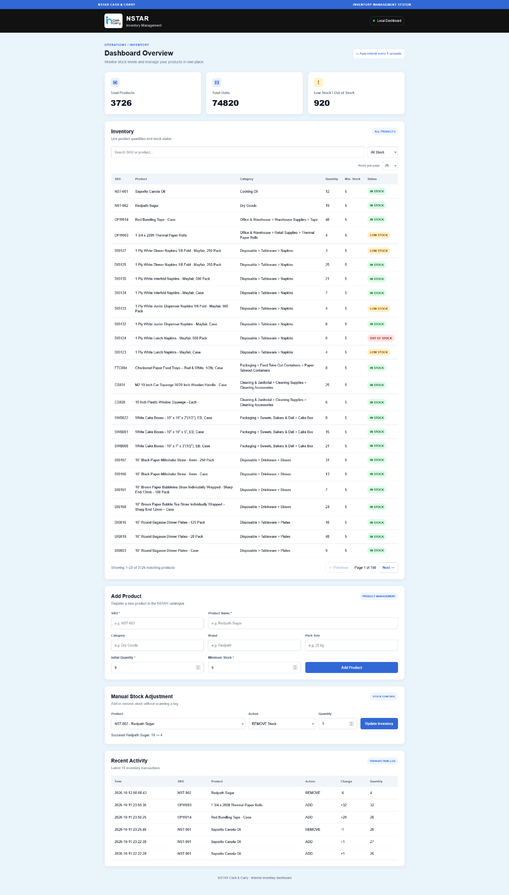
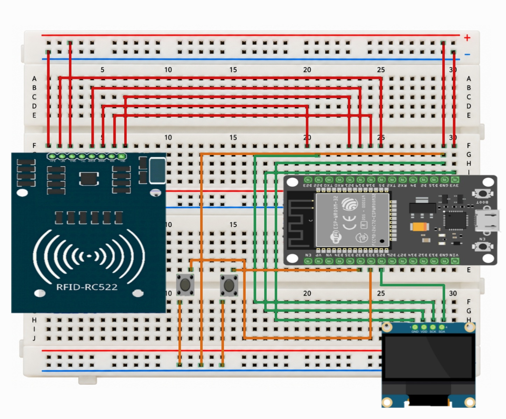
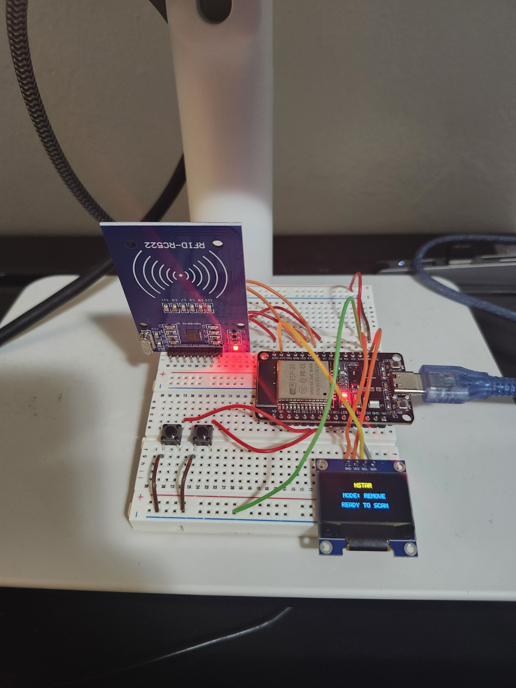
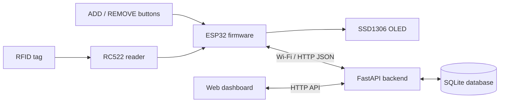

<div align="center">

# NSTAR Smart Inventory System

### RFID-powered inventory management with an ESP32, FastAPI, SQLite, and a web dashboard

    

**Version 1.0 · Working prototype**

</div>

## Overview

**NSTAR** is an end-to-end smart inventory prototype designed for a cash-and-carry environment. It combines a physical RFID scanning station with a local inventory API, a persistent database, and a browser-based dashboard.

Operators select **ADD** or **REMOVE** using physical buttons and scan a registered RFID tag. The ESP32 sends the tag identifier and action to the backend, which resolves the product, updates its stock quantity, records a transaction, and returns the result to the OLED display. Inventory can also be managed manually through the dashboard.

The project demonstrates integration across **embedded firmware, networking, backend development, relational databases, and frontend interfaces**.

## Project Demonstration

### Inventory Management Dashboard

The NSTAR web dashboard provides inventory monitoring, product management, manual stock adjustments, stock-status filtering, and transaction history.



*Inventory dashboard displaying sample product quantities and stock statuses. Quantities are demonstration data, not verified physical stock counts.*

### Hardware Wiring Diagram

The prototype integrates an ESP32 DevKit, RC522 RFID reader, SSD1306 OLED display, and two physical buttons for ADD and REMOVE operations.



*Breadboard wiring illustration of the prototype.*

### Physical Prototype

The assembled breadboard prototype connects to the FastAPI backend over Wi-Fi, while the OLED displays the selected mode and scanning feedback.



*Working ESP32-based RFID inventory scanning station.*

## Features

- **RFID stock updates:** RC522 tag scans trigger one-unit ADD or REMOVE operations for mapped products.
- **Physical controls:** Dedicated buttons select the inventory operation.
- **OLED feedback:** Displays the active mode, successful updates, quantities, and scan errors.
- **Inventory dashboard:** Browse products, search by SKU/name, and filter by stock status.
- **Pagination:** Browse inventory in pages of 25, 50, or 100 products.
- **Manual adjustments:** Add or remove stock by SKU without an RFID scan.
- **Product management:** Create products with SKU, name, category, brand, pack size, and stock thresholds.
- **Transaction history:** Records inventory changes, previous/new quantities, source, and timestamps.
- **Stock safeguards:** Rejects unknown RFID mappings and removals exceeding available quantity.
- **CSV import preview:** Validates and previews WooCommerce product CSV data without modifying the database.

## System architecture



**RFID transaction flow**

1. Select **ADD** or **REMOVE** on the ESP32 device.
2. Present an RFID tag to the RC522 reader.
3. The ESP32 sends the tag UID, action, and device ID to `POST /api/inventory/scan`.
4. FastAPI resolves the tag to a product and performs the inventory operation.
5. SQLite stores the updated quantity and transaction record.
6. The API response is shown on the OLED; the dashboard reads updated data from the backend.

## Tech stack

| Layer | Technology |
| --- | --- |
| Microcontroller | ESP32 DOIT DevKit V1 |
| Embedded firmware | C, ESP-IDF, FreeRTOS, PlatformIO |
| RFID | RC522 over SPI |
| Display | SSD1306 OLED over I²C |
| Connectivity | Wi-Fi, HTTP, JSON |
| Backend | Python, FastAPI, Pydantic |
| Database | SQLite |
| Frontend | HTML, CSS, JavaScript |

## Hardware and pin configuration

| Component | ESP32 connection |
| --- | --- |
| RC522 MISO | GPIO 19 |
| RC522 MOSI | GPIO 23 |
| RC522 SCK | GPIO 18 |
| RC522 SDA / SS | GPIO 21 |
| RC522 RST | GPIO 5 |
| OLED SDA | GPIO 25 |
| OLED SCL | GPIO 22 |
| ADD button | GPIO 32 |
| REMOVE button | GPIO 33 |

The OLED uses I²C address `0x3C`. Buttons are configured as active-low inputs with pull-ups. Verify module voltage requirements and wiring before powering the circuit.

## Project structure

```text
NstarProject/
├── src/
│   ├── main.c                  # ESP32 RFID, Wi-Fi, OLED and button logic
│   └── wifi_config.example.h   # Example Wi-Fi settings (no secrets)
├── backend/
│   ├── api.py                  # FastAPI endpoints and frontend hosting
│   ├── inventory_service.py    # Stock changes and transaction logging
│   ├── rfid_service.py         # RFID-to-product processing
│   ├── init_db.py              # SQLite schema initialization
│   └── csv_import_preview.py   # Read-only CSV preview
├── frontend/
│   ├── index.html
│   ├── style.css
│   └── script.js
├── components/                  # ESP-IDF RFID component
├── docs/
│   └── images/
│       ├── dashboard.png
│       ├── hardware-wiring.jpg
│       └── physical-prototype.jpg
├── platformio.ini
└── .gitignore
```

Local databases, credentials, build outputs, and private business exports are intentionally excluded from the public repository.

## Getting started

### Prerequisites

- Python 3 with `fastapi`, `uvicorn`, and `pydantic` installed
- VS Code with the **PlatformIO** extension for ESP32 development
- ESP32, RC522 RFID reader, SSD1306 OLED, two buttons, and appropriate wiring
- A computer and ESP32 connected to the same local network

### 1. Clone the repository

```bash
git clone https://github.com/YOUR_USERNAME/NSTAR-Smart-Inventory-System.git
cd NSTAR-Smart-Inventory-System
```

Replace `YOUR_USERNAME` with the repository owner's GitHub username.

### 2. Set up the backend

From the project root, create a virtual environment and install the Python dependencies:

```bash
python -m venv .venv
```

Activate it on Windows PowerShell:

```powershell
.\.venv\Scripts\Activate.ps1
```

Then install dependencies and initialize a **new, empty** SQLite database:

```bash
python -m pip install fastapi "uvicorn[standard]" pydantic
python -m backend.init_db
```

> The database is created locally at `backend/nstar.db`. It is not included in the public repository. A new installation starts with no products or RFID mappings.

### 3. Start the application

From the project root:

```bash
python -m uvicorn backend.api:app --host 0.0.0.0 --port 8000 --reload
```

Open:

- **Dashboard:** http://127.0.0.1:8000/
- **Interactive API docs:** http://127.0.0.1:8000/docs
- **Health endpoint:** http://127.0.0.1:8000/api/health

The frontend is served by FastAPI; a separate frontend server is not required.

### 4. Configure the ESP32

Create a local `src/wifi_config.h` file based on `src/wifi_config.example.h`:

```c
#ifndef WIFI_CONFIG_H
#define WIFI_CONFIG_H

#define WIFI_SSID "YOUR_WIFI_NAME"
#define WIFI_PASSWORD "YOUR_WIFI_PASSWORD"

#endif
```

Keep `src/wifi_config.h` in `.gitignore` and **never commit real credentials**.

In `src/main.c`, update the two local backend URLs to use the IP address of the computer running FastAPI:

```text
http://YOUR_COMPUTER_IP:8000/api/inventory/scan
http://YOUR_COMPUTER_IP:8000/
```

Build and upload the firmware using PlatformIO. Start the FastAPI server before testing scans, and ensure the computer's firewall allows the ESP32 to reach port `8000` on the local network.

### 5. Add products and associate RFID tags

Create products through the dashboard or `POST /api/products`. To use physical RFID scans, each tag UID must be associated with a product in the database. This prototype does not include a dedicated RFID tag-registration screen.

For a local test database, a UID can be associated with an existing product using SQLite:

```sql
UPDATE products
SET rfid_uid = 'YOUR_TAG_UID'
WHERE sku = 'YOUR_TEST_SKU';
```

Use a tag you own or are authorized to use. Scan it with the selected ADD/REMOVE mode and check the dashboard and transaction history.

## API overview

| Method | Endpoint | Purpose |
| --- | --- | --- |
| `GET` | `/api/health` | Service health check |
| `GET` | `/api/inventory` | List active inventory |
| `GET` | `/api/inventory/paged` | Paginated inventory, search, filters, and summary |
| `POST` | `/api/inventory/scan` | Process an RFID inventory action |
| `POST` | `/api/inventory/manual` | Manually add/remove stock |
| `GET` | `/api/transactions` | View the 10 most recent transactions |
| `POST` | `/api/products` | Create a product |
| `POST` | `/api/products/import-preview` | Preview a CSV without importing it |

Example RFID request:

```json
{
  "rfid_uid": "YOUR_TAG_UID",
  "action": "ADD",
  "device_id": "NSTAR-ESP32-01"
}
```

See `/docs` for the interactive API specification.

## Data model

The SQLite database has three core tables:

- **`products`** — SKU, product details, optional RFID UID, and active status.
- **`inventory`** — current quantity, minimum stock threshold, and last update time.
- **`transactions`** — audit trail of ADD/REMOVE actions, quantity changes, source, device ID, and timestamp.

Stock changes and their transaction records are written together in a database transaction.

## Scope and limitations

NSTAR V1.0 is a **local-network prototype**, not a production-ready enterprise inventory platform. It requires a running FastAPI server and a reachable Wi-Fi network. A fresh checkout does not include business inventory data or pre-registered RFID tags.

The API is intended for a trusted development network and does **not** include user authentication or HTTPS. Do not expose port `8000` directly to the public internet or deploy it with real business data without adding appropriate security controls.

## Future possibilities

Potential extensions include an RFID enrollment interface, barcode scanning, multi-device support, role-based access, and advanced inventory reporting. These are **not required for the V1 prototype**.

---

<div align="center">

**NSTAR Smart Inventory System · Version 1.0**  
*Embedded systems × backend engineering × database design × web development*

</div>
